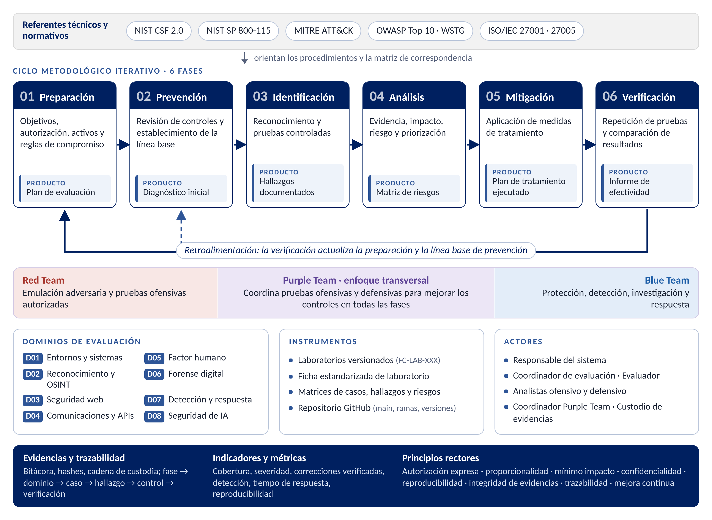

# FORTIS

**Framework metodológico para la evaluación, análisis y fortalecimiento de la ciberseguridad**

Autor: **Edward Fernando Ávila Ojeda** · Universidad Santo Tomás, seccional Tunja

📄 Documento completo: [Word](docs/FORTIS_Framework.docx) · [PDF](docs/FORTIS_Framework.pdf)

## ¿Qué es?

FORTIS es un marco metodológico que organiza las evaluaciones de ciberseguridad en un ciclo de seis fases: preparación, prevención, identificación, análisis, mitigación y verificación. Integra los enfoques Red Team, Blue Team y Purple Team, y se apoya en referentes como NIST CSF 2.0, NIST SP 800-115, MITRE ATT&CK, OWASP e ISO/IEC 27001 y 27005. Los laboratorios del curso se incorporan como instrumentos del marco. El nombre viene del latín *fortis*, que significa "fuerte".



## Ciclo metodológico

| Fase | Finalidad | Producto |
|---|---|---|
| 01 Preparación | Definir objetivos, autorización, activos y reglas | Plan de evaluación |
| 02 Prevención | Examinar controles y establecer la línea base | Diagnóstico inicial |
| 03 Identificación | Ejecutar reconocimiento y pruebas controladas | Hallazgos documentados |
| 04 Análisis | Evaluar evidencia, impacto y riesgo | Matriz de riesgos |
| 05 Mitigación | Aplicar medidas de tratamiento | Plan de tratamiento ejecutado |
| 06 Verificación | Repetir pruebas y comparar resultados | Informe de efectividad |

## Estructura del repositorio

```
FORTIS-framework/
├── README.md                  ← esta página
├── docs/                      ← documento completo (Word y PDF), figuras y capítulos en Markdown
│   ├── framework.md           ← escenario, fundamentos, referentes y referencias
│   ├── arquitectura.md        ← definición y arquitectura metodológica
│   ├── metodologia.md         ← fases, actores, dominios, catálogo, evaluación y métricas
│   └── glosario.md
├── framework/
│   ├── fases/                 ← especificación de las 6 fases y actores
│   ├── protocolos/            ← principios, ficha de laboratorio, publicación y evidencias
│   └── matrices/              ← matrices de correspondencia y rúbrica de severidad
├── laboratorios/              ← los 10 laboratorios del curso, cada uno con su ficha
├── plantillas/                ← formatos de los anexos A a D (CSV) y ficha de laboratorio
├── casos-estudio/             ← casos de prueba P01 a P03
├── resultados/                ← resultados de los casos ejecutados
└── scripts/                   ← script para calcular hashes SHA-256
```

## Laboratorios

| ID | Laboratorio | Dominio | Enfoque |
|---|---|---|---|
| [FC-LAB-001](laboratorios/lab-01-shell/) | Comandos Shell y Kali Linux | D01 | Transversal |
| [FC-LAB-002](laboratorios/lab-02-dns/) | DNS footprinting con nslookup y dig | D02 | Ofensivo controlado (reconocimiento pasivo) |
| [FC-LAB-003](laboratorios/lab-03-httrack/) | Clonación controlada con HTTrack | D03 | Ofensivo y defensivo |
| [FC-LAB-004](laboratorios/lab-04-esteganografia/) | Esteganografía con Steghide (partes 1 a 3) | D06 | Forense y colaborativo |
| [FC-LAB-005](laboratorios/lab-05-ingenieria-social/) | Ingeniería social: construcción y análisis de escenarios | D05 | Factor humano (defensivo) |
| [FC-LAB-006](laboratorios/lab-06-maltego/) | Maltego: instalación y reconocimiento de infraestructura | D02 | OSINT |
| [FC-LAB-007](laboratorios/lab-07-burp/) | Interceptación de autenticación con Burp Suite | D03 | Pruebas web y APIs |
| [FC-LAB-008](laboratorios/lab-08-prompt-injection/) | Prompt injection en sistemas basados en modelos de lenguaje | D08 | Seguridad de IA |
| [FC-LAB-009](laboratorios/lab-09-dvwa/) | Vulnerabilidades web en DVWA | D03 | Ofensivo controlado (Red Team) |
| [FC-LAB-010](laboratorios/lab-10-dvwa-explotacion/) | Explotación en DVWA: carga e inclusión de archivos y XSS | D03 | Ofensivo controlado (Red Team) |

## Uso ético

Todas las pruebas se realizaron en entornos de práctica o autorizados (por ejemplo, DVWA en un entorno local, OWASP Juice Shop y el dominio de prueba `scanme.nmap.org`). Este material es académico: sus procedimientos no deben aplicarse a sistemas sin autorización expresa de su responsable.
