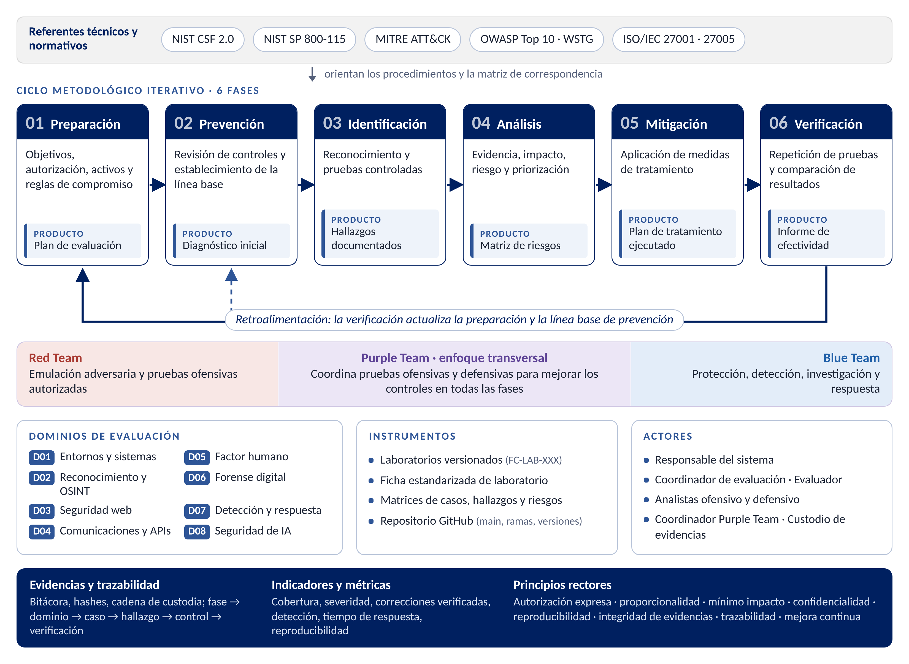

# Definición y arquitectura metodológica

> Parte del documento **FORTIS** · versión completa en [`docs/FORTIS_Framework.docx`](FORTIS_Framework.docx) y [PDF](FORTIS_Framework.pdf).

## 5. DEFINICIÓN DE FORTIS

### 5.1. Definición

FORTIS es una propuesta de framework metodológico que reúne procedimientos ofensivos, defensivos y colaborativos para identificar, analizar, evaluar, mitigar y verificar riesgos de ciberseguridad, a partir de pruebas controladas, evidencias reproducibles y mejora continua. El nombre FORTIS viene del latín y significa "fuerte", porque el objetivo del marco es fortalecer la ciberseguridad de los sistemas que se evalúan.

### 5.2. Objetivo general

Plantear una forma ordenada de evaluar y fortalecer los controles de ciberseguridad de un sistema de información, usando procedimientos técnicos autorizados y verificables.

### 5.3. Objetivos específicos

Delimitar el alcance; establecer línea base; ejecutar pruebas; registrar y analizar hallazgos; priorizar tratamientos; repetir pruebas y documentar efectividad.

### 5.4. Alcance

Se puede aplicar a entornos de laboratorio, aplicaciones web, APIs, servicios de red, archivos digitales, procesos humanos y aplicaciones con IA, según los permisos y las capacidades que se tengan.

### 5.5. Principios rectores

Autorización expresa, proporcionalidad, mínimo impacto, confidencialidad, reproducibilidad, integridad de evidencias, trazabilidad y mejora continua.

### 5.6. Limitaciones

El framework no garantiza que no existan vulnerabilidades; lo que se logra cubrir depende del alcance, las herramientas y los escenarios usados.

## 6. ARQUITECTURA METODOLÓGICA

| Fase              | Finalidad                                         | Producto                      |
|-------------------|---------------------------------------------------|-------------------------------|
| 01 Preparación    | Definir objetivos, autorización, activos y reglas | Plan de evaluación            |
| 02 Prevención     | Examinar controles y establecer línea base        | Diagnóstico inicial           |
| 03 Identificación | Ejecutar reconocimiento y pruebas controladas     | Hallazgos documentados        |
| 04 Análisis       | Evaluar evidencia, impacto y riesgo               | Matriz de riesgos             |
| 05 Mitigación     | Aplicar medidas de tratamiento                    | Plan de tratamiento ejecutado |
| 06 Verificación   | Repetir pruebas y comparar resultados             | Informe de efectividad        |

En la Figura 1 se muestra la arquitectura metodológica de FORTIS. Los referentes técnicos y normativos guían un ciclo de seis fases, y cada fase entrega un producto. El enfoque Purple Team une las actividades ofensivas (Red Team) y defensivas (Blue Team) durante todo el ciclo. Los dominios, los instrumentos y los actores se usan según el alcance aprobado, y la gestión de evidencias, los indicadores y los principios sirven de base para todo el proceso.

**Figura 1.** *Arquitectura metodológica de FORTIS.*

La arquitectura es cíclica: lo que se encuentra en la verificación sirve para mejorar la preparación y la prevención del siguiente ciclo. Los procedimientos se pueden adaptar al dominio y al alcance aprobado.
