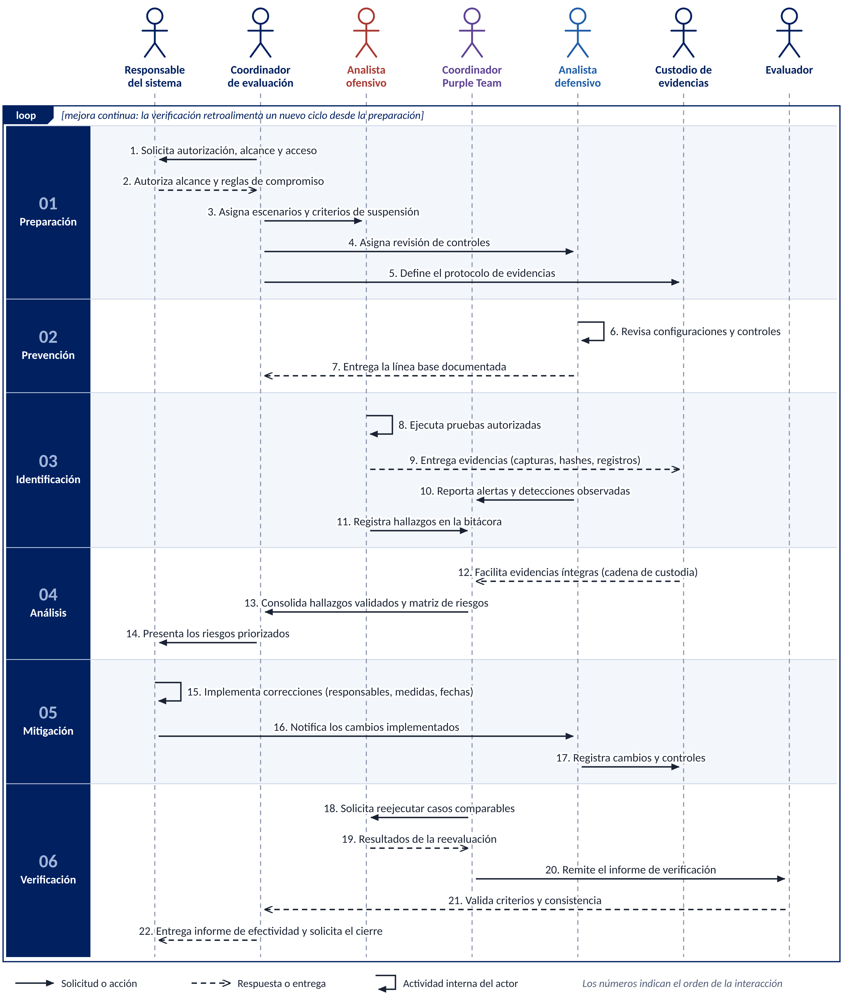

# Metodología: fases, actores, aplicación y evaluación

> Parte del documento **EDWARD_FW** · versión completa en [`docs/EDWARD_FW_Framework.docx`](EDWARD_FW_Framework.docx) y [PDF](EDWARD_FW_Framework.pdf).

## 7. ESPECIFICACIÓN DE LAS FASES

### 7.1. Preparación

Entradas: Solicitud, sistema y autorización.

Actividades: Definir alcance, activos, reglas de compromiso, responsables y entorno.

Salidas: Plan autorizado y criterios de suspensión.

Criterio de cierre: el responsable del sistema aprueba el plan de evaluación, y quedan documentados el alcance, los activos, las reglas de compromiso, los criterios de suspensión y los roles.

### 7.2. Prevención

Entradas: Plan, arquitectura y controles existentes.

Actividades: Revisar configuraciones, controles, exposición y riesgos conocidos.

Salidas: Línea base documentada.

Criterio de cierre: queda registrada la línea base con la configuración y los controles de cada activo, la lista de riesgos conocidos y el diagnóstico revisado por el coordinador de evaluación.

### 7.3. Identificación

Entradas: Escenarios y protocolos.

Actividades: Ejecutar pruebas controladas; registrar observaciones y hallazgos.

Salidas: Bitácora y evidencias.

Criterio de cierre: se ejecutaron los casos planeados (o se justificó por qué no) y cada hallazgo tiene su evidencia registrada en el Anexo C, con identificador, hash y responsable.

### 7.4. Análisis

Entradas: Hallazgos y evidencias.

Actividades: Validar hallazgos, determinar impacto, estimar riesgo y priorizar.

Salidas: Matriz de evaluación.

Criterio de cierre: los hallazgos están validados, tienen severidad asignada con la rúbrica de la sección 13.1 y la matriz de hallazgos y riesgos (Anexo B) fue revisada y aprobada por el coordinador de evaluación.

### 7.5. Mitigación

Entradas: Riesgos priorizados.

Actividades: Seleccionar responsables, medidas y fechas; implementar correcciones.

Salidas: Registro de cambios y controles.

Criterio de cierre: cada riesgo priorizado tiene medida, responsable y fecha en el plan de mitigación (Anexo D), los cambios quedaron registrados y los riesgos aceptados están justificados y aprobados por el responsable del sistema.

### 7.6. Verificación

Entradas: Cambios y pruebas iniciales.

Actividades: Reejecutar casos comparables; comprobar correcciones y regresiones.

Salidas: Informe de verificación.

Criterio de cierre: se repitieron los casos de prueba, las correcciones se confirmaron (o se reabrieron), no quedan regresiones críticas y el informe de efectividad fue validado por el evaluador y aprobado por el responsable del sistema.

## 8. ACTORES Y RESPONSABILIDADES

| Actor                     | Responsabilidad                                     |
|---------------------------|-----------------------------------------------------|
| Responsable del sistema   | Autoriza alcance y facilita acceso legítimo.        |
| Coordinador de evaluación | Planifica, supervisa y aprueba procedimientos.      |
| Analista ofensivo         | Ejecuta pruebas autorizadas y registra resultados.  |
| Analista defensivo        | Revisa controles, registros y acciones correctivas. |
| Coordinador Purple Team   | Integra aprendizajes y verifica mejoras.            |
| Custodio de evidencias    | Preserva integridad, acceso y trazabilidad.         |
| Evaluador                 | Revisa criterios y consistencia de resultados.      |

La Figura 2 es un diagrama de secuencia UML que muestra cómo interactúan los actores durante las seis fases. Cada flecha indica qué actor inicia una acción y quién la recibe, y el número muestra el orden. El recuadro loop indica que el ciclo se repite cuando la verificación genera nuevos ajustes.

**Figura 2.** *Diagrama de secuencia UML: interacción de responsabilidades entre los actores.*

**Lectura del diagrama.** El Coordinador de evaluación es quien planea y aprueba. El Responsable del sistema autoriza al inicio, hace las correcciones y recibe el informe final. Los analistas ofensivo y defensivo trabajan coordinados por el Coordinador Purple Team. El Custodio de evidencias recibe y guarda lo que se genera en cada fase. Por último, el Evaluador revisa los resultados antes del cierre sin haber participado en la ejecución, para que quien hace las pruebas no sea el mismo que las verifica.

## 9. DOMINIOS DE EVALUACIÓN

| Código | Dominio                | Propósito                                           |
|--------|------------------------|-----------------------------------------------------|
| D01    | Entornos y sistemas    | Preparación de herramientas, comandos y permisos.   |
| D02    | Reconocimiento y OSINT | Exposición pública y relaciones de infraestructura. |
| D03    | Seguridad web          | Análisis de aplicaciones y recursos expuestos.      |
| D04    | Comunicaciones y APIs  | Solicitudes, autenticación y controles de acceso.   |
| D05    | Factor humano          | Ingeniería social y seguridad organizacional.       |
| D06    | Forense digital        | Inspección y preservación de evidencias.            |
| D07    | Detección y respuesta  | Alertas, registros y controles defensivos.          |
| D08    | Seguridad de IA        | Riesgos de prompt injection en LLM.                 |

## 10. CATÁLOGO DE LABORATORIOS

| ID         | Laboratorio / documento base                                                           | Dominio | Enfoque                        | Estado   |
|------------|----------------------------------------------------------------------------------------|---------|--------------------------------|----------|
| FC-LAB-001 | Comandos Shell y Kali Linux                                                            | D01     | Transversal                    | Abordado |
| FC-LAB-002 | DNS Footprinting con nslookup y dig                                                    | D02     | Ofensivo controlado            | Abordado |
| FC-LAB-003 | Clonación controlada HTTrack                                                           | D03     | Ofensivo/defensivo             | Abordado |
| FC-LAB-004 | Esteganografía con Steghide: partes 1–3                                                | D06     | Forense y colaborativo         | Abordado |
| FC-LAB-005 | Ingeniería social: principios                                                          | D05     | Factor humano                  | Abordado |
| FC-LAB-006 | Maltego: instalación y aplicación                                                      | D02     | OSINT                          | Abordado |
| FC-LAB-007 | Burp Suite                                                                             | D03/D04 | Pruebas web                    | Abordado |
| FC-LAB-008 | Prompt injection en sistemas basados en modelos de lenguaje                            | D08     | Seguridad de IA                | Abordado |
| FC-LAB-009 | Vulnerabilidades web en DVWA: fuerza bruta, SQL injection, command injection y XSS     | D03     | Ofensivo controlado (Red Team) | Abordado |
| FC-LAB-010 | Explotación en DVWA: carga de archivos, inclusión de archivos y robo de sesión con XSS | D03     | Ofensivo controlado (Red Team) | Abordado |

Los laboratorios FC-LAB-001 a FC-LAB-010 son los diez laboratorios realizados en el curso, y sus documentos están en la carpeta laboratorios/ del repositorio (sección 11). Entre todos cubren los dominios D01 a D06 y D08. El dominio D07 (detección y respuesta) todavía no tiene un laboratorio y queda como trabajo futuro. La relación de cada laboratorio con un dominio y un enfoque es una propuesta propia, ya que no todas las guías de los laboratorios la indican.

### 10.1. Ficha estandarizada de laboratorio

| Campo                  | Descripción / dato requerido          |
|------------------------|---------------------------------------|
| Identificador          | FC-LAB-XXX                            |
| Nombre y versión       | Título, fecha y control de cambios    |
| Objetivo               | Capacidad que se desea evaluar        |
| Dominio y fase         | Código de dominio y fase aplicable    |
| Roles                  | Ejecutor, defensor, revisor           |
| Entorno y autorización | Sistema, alcance y permisos           |
| Entradas               | Datos sintéticos y configuraciones    |
| Procedimiento          | Pasos reproducibles                   |
| Evidencias             | Archivos, capturas, hashes, registros |
| Criterio de aceptación | Condición observable y verificable    |
| Análisis defensivo     | Controles y recomendaciones           |
| Resultado              | Informe y matriz de evaluación        |

## 11. REPOSITORIO TÉCNICO Y GESTIÓN DE ARTEFACTOS

Se propone un solo repositorio en GitHub con carpetas por función. Las ramas se usan para cambios temporales y revisión, y los laboratorios quedan como carpetas fijas en main.

EDWARD_FW-framework/  
README.md  
docs/{framework,arquitectura,metodologia,glosario}.md  
framework/{fases,protocolos,matrices}/  
laboratorios/{lab-01-shell,lab-02-dns,lab-03-httrack,lab-04-esteganografia,lab-05-ingenieria-social,lab-06-maltego,lab-07-burp,  
lab-08-prompt-injection,lab-09-dvwa,lab-10-dvwa-explotacion}/  
scripts/ plantillas/ casos-estudio/ resultados/

### 11.1. Ramas y versiones

La rama main tiene la versión estable, y ramas como feature/lab-08 o docs/glosario se usan para trabajar. Los cambios se revisan con Pull Requests y las versiones estables se marcan con etiquetas como v0.1.0, v0.2.0 y v1.0.0.

### 11.2. Seguridad de publicación

No subir credenciales, tokens, datos personales, información de terceros, capturas sensibles ni artefactos que permitan afectar objetivos reales. Usar escenarios autorizados, archivos sintéticos y resultados anonimizados.

### 11.3. Trazabilidad

Cada laboratorio debe vincularse con:

- Fase

- Dominio

- Caso de prueba

- Hallazgo

- Control

- Resultado de verificación

## 12. MODELO DE EVALUACIÓN

Cada prueba tiene identificador, objetivo, condiciones, entrada, resultado esperado, resultado observado, evidencia, impacto, severidad, responsable y recomendación. Hay que tener en cuenta que ejecutar bien una prueba no significa que el sistema no tenga vulnerabilidades. El detalle de cada caso está en el Anexo A y los hallazgos en el Anexo B.

| ID  | Prueba             | Resultado esperado            | Resultado obtenido                                                                      | Severidad   | Estado    |
|-----|--------------------|-------------------------------|-----------------------------------------------------------------------------------------|-------------|-----------|
| P01 | Reconocimiento DNS | Información documentada       | IP de scanme.nmap.org y servidores NS y MX de nmap.org identificados (FC-LAB-002)       | Informativa | Ejecutada |
| P02 | Exposición web     | Recursos identificados        | Solo se recuperaron archivos CSS y caché; sin datos sensibles ni endpoints (FC-LAB-003) | Informativa | Ejecutada |
| P03 | Análisis forense   | Evidencia íntegra y analizada | Mensajes ocultos extraídos con Steghide; hashes SHA-256 coinciden (FC-LAB-004)          | Informativa | Ejecutada |

## 13. INDICADORES Y MÉTRICAS

| Indicador                | Definición operacional propuesta                                         |
|--------------------------|--------------------------------------------------------------------------|
| Cobertura de pruebas     | Casos ejecutados / casos planificados × 100.                             |
| Hallazgos por severidad  | Conteo por nivel bajo, medio, alto y crítico, según rúbrica documentada. |
| Correcciones verificadas | Hallazgos corregidos y verificados / hallazgos tratados × 100.           |
| Tasa de detección        | Eventos de prueba detectados / eventos de prueba observables × 100.      |
| Tiempo de respuesta      | Diferencia entre evento y respuesta, bajo reloj y criterios definidos.   |
| Reproducibilidad         | Coincidencia de resultados en repeticiones con condiciones equivalentes. |

Para usar estos indicadores hay que definir la fuente, la unidad, el periodo de tiempo, los criterios de exclusión y los umbrales. La severidad se mide con la rúbrica de la sección 13.1, que debe estar definida antes de hacer las pruebas.

### 13.1. Rúbrica de severidad

La severidad de cada hallazgo se asigna con esta rúbrica antes de reportarlo. Si es una vulnerabilidad técnica se usa el puntaje base de CVSS v4.0. Si el hallazgo tiene que ver con procesos, configuración de la organización o factor humano, donde CVSS no aplica, se usa la matriz de probabilidad e impacto. Si se pueden usar los dos criterios y dan niveles diferentes, se toma el más alto y se explica en el Anexo B. Cuando algo no representa riesgo (CVSS 0.0) se registra como informativo y no se cuenta como hallazgo.

| **Nivel**   | **Puntaje CVSS v4.0** | **Criterio de impacto**                                                                                                                            | **Ejemplo orientativo**                                                 | **Plazo de tratamiento sugerido**                  |
|-------------|-----------------------|----------------------------------------------------------------------------------------------------------------------------------------------------|-------------------------------------------------------------------------|----------------------------------------------------|
| **Crítico** | 9.0 – 10.0            | Compromiso total de la confidencialidad, integridad o disponibilidad de activos críticos; explotable sin autenticación ni interacción del usuario. | Ejecución remota de código en un servidor expuesto.                     | Contención inmediata; corrección en máximo 7 días. |
| **Alto**    | 7.0 – 8.9             | Acceso no autorizado a información sensible o a funciones privilegiadas con condiciones mínimas.                                                   | Acceso a datos de otros usuarios por fallas de autorización en una API. | Máximo 30 días.                                    |
| **Medio**   | 4.0 – 6.9             | Impacto limitado, o que requiere condiciones específicas (autenticación previa, interacción del usuario).                                          | Listado de directorios habilitado con archivos internos no sensibles.   | Máximo 90 días.                                    |
| **Bajo**    | 0.1 – 3.9             | Impacto mínimo; aporta información útil para un atacante sin afectar directamente los activos.                                                     | Mensajes de error que revelan la versión del software.                  | Próximo ciclo de mejora.                           |

*Los plazos son una propuesta y se pueden ajustar según la política de la organización o lo que se acuerde con el responsable del sistema.*

**Matriz de probabilidad e impacto**

| **Probabilidad / Impacto** | **Impacto bajo** | **Impacto medio** | **Impacto alto** |
|----------------------------|------------------|-------------------|------------------|
| **Alta**                   | Medio            | Alto              | Crítico          |
| **Media**                  | Bajo             | Medio             | Alto             |
| **Baja**                   | Bajo             | Bajo              | Medio            |

| **Término**            | **Definición operacional**                                                      |
|------------------------|---------------------------------------------------------------------------------|
| **Probabilidad alta**  | Se puede explotar con herramientas públicas y sin conocimientos especializados. |
| **Probabilidad media** | Requiere condiciones particulares o conocimientos específicos.                  |
| **Probabilidad baja**  | Requiere acceso privilegiado o condiciones poco frecuentes.                     |
| **Impacto alto**       | Afecta activos críticos, datos personales o información sensible.               |
| **Impacto medio**      | Afecta activos de apoyo o información interna no sensible.                      |
| **Impacto bajo**       | No afecta directamente la información ni la operación.                          |

## 14. VALIDACIÓN Y MEJORA CONTINUA

### 14.1. Diseño de validación

Establecer preguntas de evaluación, criterios y limitaciones.

### 14.2. Selección de escenarios

Elegir sistemas propios o expresamente autorizados.

### 14.3. Línea base

Aplicar pruebas y medir condiciones iniciales.

### 14.4. Tratamiento

Implementar controles y documentar cambios.

### 14.5. Reevaluación

Repetir pruebas equivalentes y analizar regresiones.

### 14.6. Análisis

Interpretar cobertura, resultados, reproducibilidad y amenazas a la validez.

### 14.7. Retroalimentación

Actualizar protocolos, fichas y criterios metodológicos.
