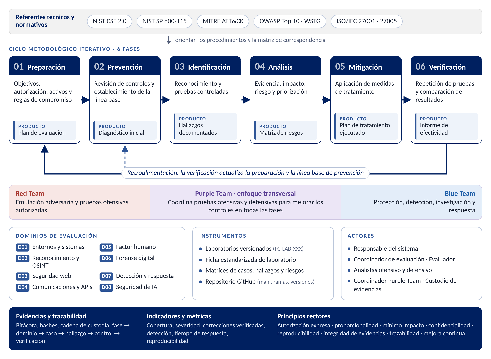
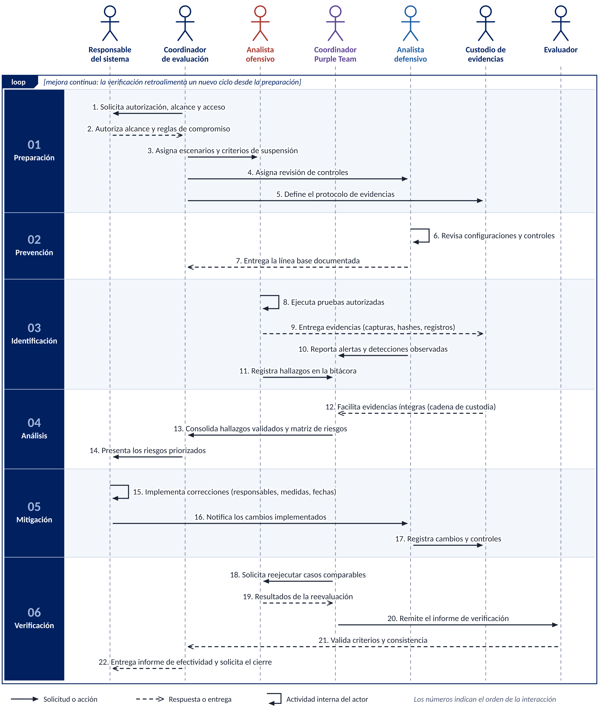

# Fases del ciclo metodológico

> Parte del documento **EDWARD_FW** · versión completa en [`docs/EDWARD_FW_Framework.docx`](../../docs/EDWARD_FW_Framework.docx) y [PDF](../../docs/EDWARD_FW_Framework.pdf).

## 7. ESPECIFICACIÓN DE LAS FASES

### 7.1. Preparación

Entradas: Solicitud, sistema y autorización.

Actividades: Definir alcance, activos, reglas de compromiso, responsables y entorno.

Salidas: Plan autorizado y criterios de suspensión.

Criterio de cierre: el responsable del sistema aprueba el plan de evaluación, y quedan documentados el alcance, los activos, las reglas de compromiso, los criterios de suspensión y los roles.

### 7.2. Prevención

Entradas: Plan, arquitectura y controles existentes.

Actividades: Revisar configuraciones, controles, exposición y riesgos conocidos.

Salidas: Línea base documentada.

Criterio de cierre: queda registrada la línea base con la configuración y los controles de cada activo, la lista de riesgos conocidos y el diagnóstico revisado por el coordinador de evaluación.

### 7.3. Identificación

Entradas: Escenarios y protocolos.

Actividades: Ejecutar pruebas controladas; registrar observaciones y hallazgos.

Salidas: Bitácora y evidencias.

Criterio de cierre: se ejecutaron los casos planeados (o se justificó por qué no) y cada hallazgo tiene su evidencia registrada en el Anexo C, con identificador, hash y responsable.

### 7.4. Análisis

Entradas: Hallazgos y evidencias.

Actividades: Validar hallazgos, determinar impacto, estimar riesgo y priorizar.

Salidas: Matriz de evaluación.

Criterio de cierre: los hallazgos están validados, tienen severidad asignada con la rúbrica de la sección 13.1 y la matriz de hallazgos y riesgos (Anexo B) fue revisada y aprobada por el coordinador de evaluación.

### 7.5. Mitigación

Entradas: Riesgos priorizados.

Actividades: Seleccionar responsables, medidas y fechas; implementar correcciones.

Salidas: Registro de cambios y controles.

Criterio de cierre: cada riesgo priorizado tiene medida, responsable y fecha en el plan de mitigación (Anexo D), los cambios quedaron registrados y los riesgos aceptados están justificados y aprobados por el responsable del sistema.

### 7.6. Verificación

Entradas: Cambios y pruebas iniciales.

Actividades: Reejecutar casos comparables; comprobar correcciones y regresiones.

Salidas: Informe de verificación.

Criterio de cierre: se repitieron los casos de prueba, las correcciones se confirmaron (o se reabrieron), no quedan regresiones críticas y el informe de efectividad fue validado por el evaluador y aprobado por el responsable del sistema.

## 8. ACTORES Y RESPONSABILIDADES

| Actor                     | Responsabilidad                                     |
|---------------------------|-----------------------------------------------------|
| Responsable del sistema   | Autoriza alcance y facilita acceso legítimo.        |
| Coordinador de evaluación | Planifica, supervisa y aprueba procedimientos.      |
| Analista ofensivo         | Ejecuta pruebas autorizadas y registra resultados.  |
| Analista defensivo        | Revisa controles, registros y acciones correctivas. |
| Coordinador Purple Team   | Integra aprendizajes y verifica mejoras.            |
| Custodio de evidencias    | Preserva integridad, acceso y trazabilidad.         |
| Evaluador                 | Revisa criterios y consistencia de resultados.      |

La Figura 2 es un diagrama de secuencia UML que muestra cómo interactúan los actores durante las seis fases. Cada flecha indica qué actor inicia una acción y quién la recibe, y el número muestra el orden. El recuadro loop indica que el ciclo se repite cuando la verificación genera nuevos ajustes.

**Figura 2.** *Diagrama de secuencia UML: interacción de responsabilidades entre los actores.*

**Lectura del diagrama.** El Coordinador de evaluación es quien planea y aprueba. El Responsable del sistema autoriza al inicio, hace las correcciones y recibe el informe final. Los analistas ofensivo y defensivo trabajan coordinados por el Coordinador Purple Team. El Custodio de evidencias recibe y guarda lo que se genera en cada fase. Por último, el Evaluador revisa los resultados antes del cierre sin haber participado en la ejecución, para que quien hace las pruebas no sea el mismo que las verifica.
